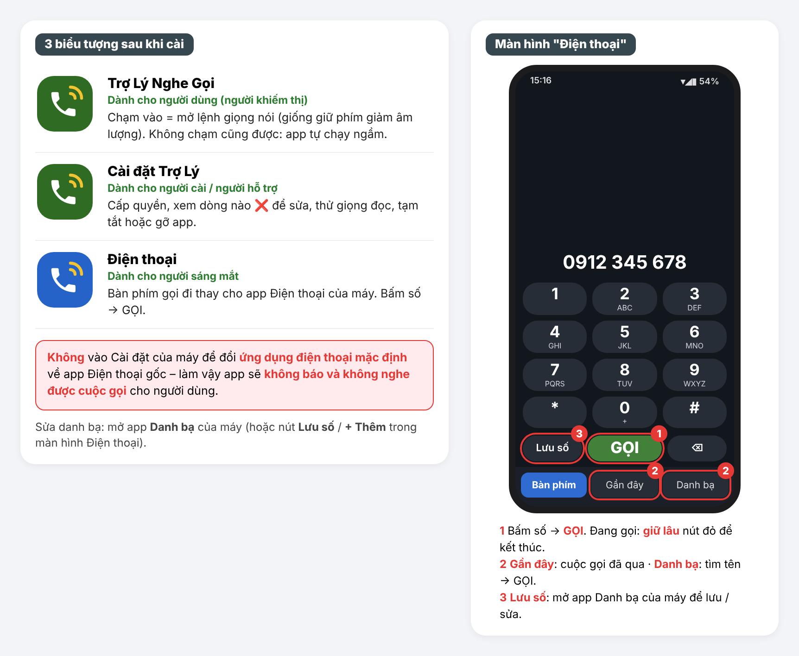
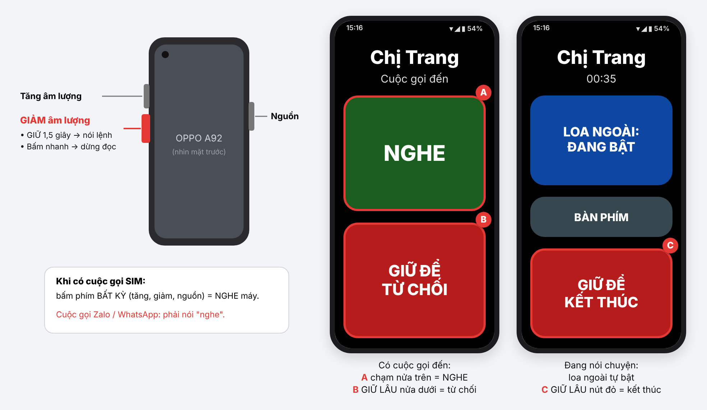
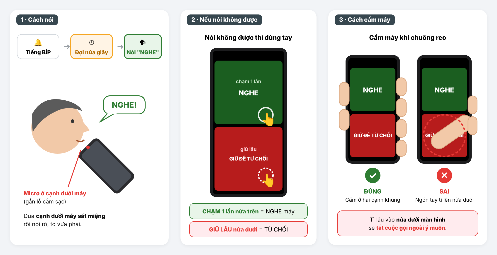
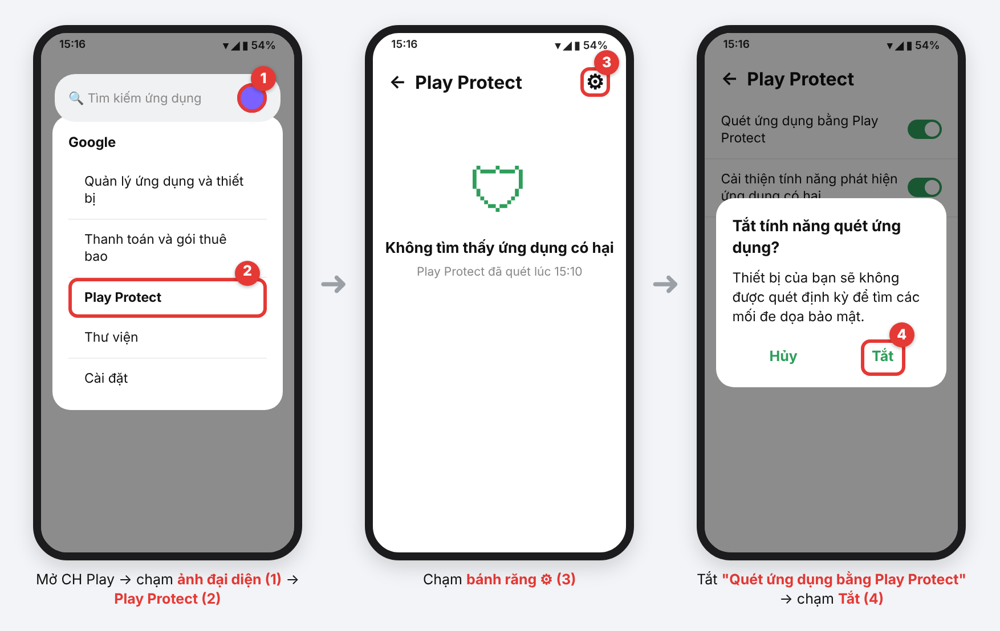
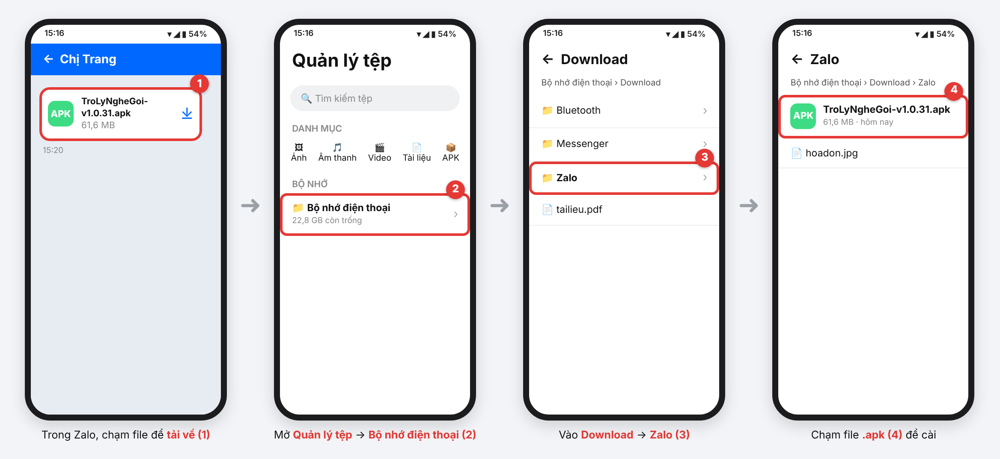
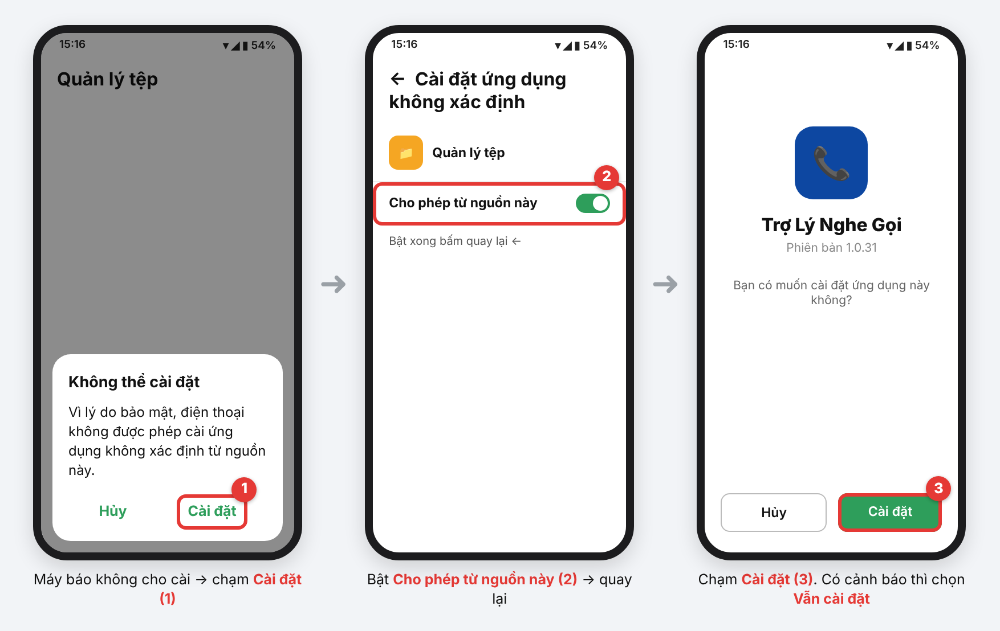
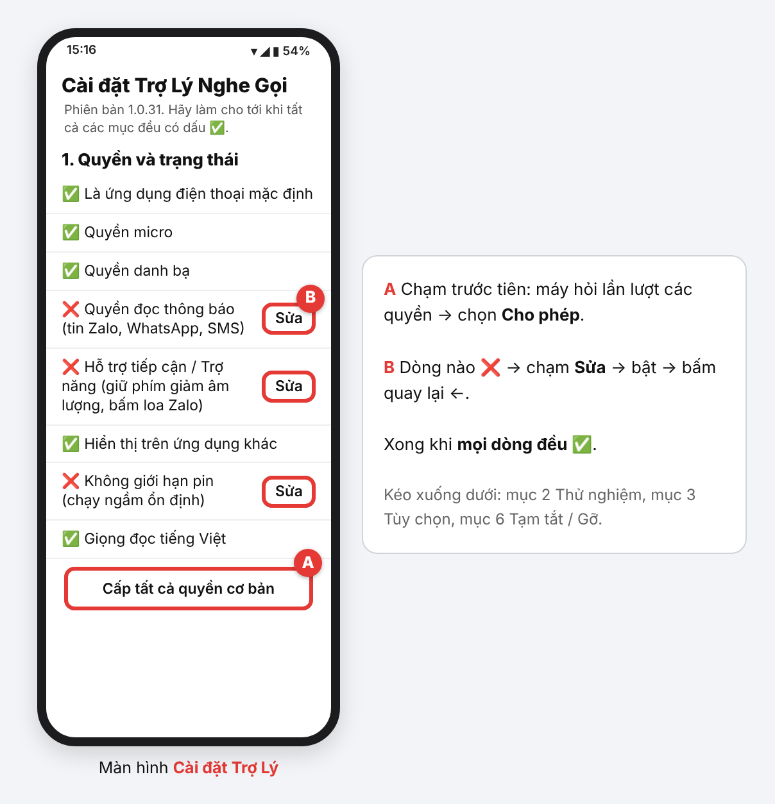
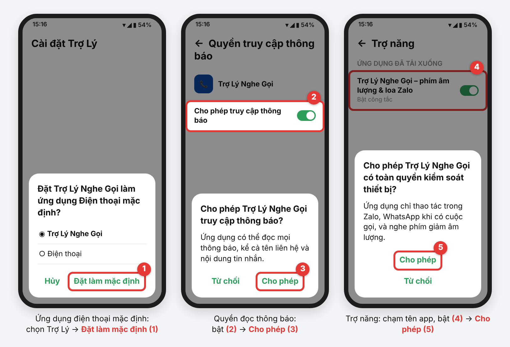
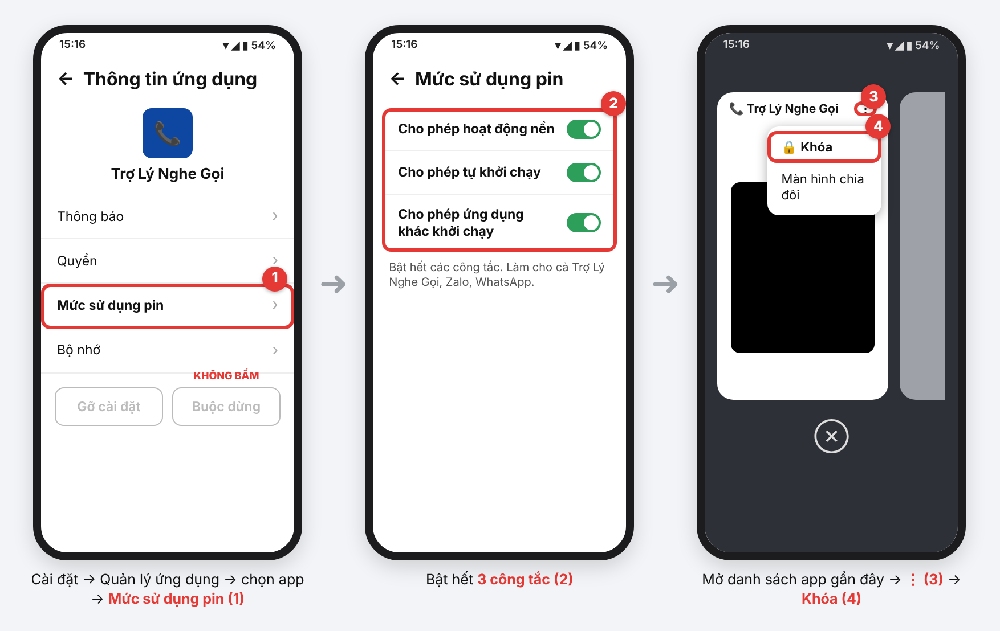

# Hướng dẫn cài đặt và sử dụng Trợ Lý Nghe Gọi

Viết theo bản v1.0.32. Bản mới nhất luôn có ở [trang Releases](https://github.com/dphuonganh019/blind-support/releases).

## Trước khi bắt đầu

Tài liệu này dành cho **người hỗ trợ** – người sáng mắt cài đặt app giúp **người dùng** là người khiếm thị. Làm một lần, mất khoảng **30 phút**, theo đúng thứ tự Bước 1 → Bước 6. Cài xong, đọc cho người dùng nghe phần **Cách sử dụng hằng ngày** và cùng người dùng tập vài lần.

Cần chuẩn bị:

- Điện thoại **Android 10 trở lên** của người dùng, pin trên 50%, đang nối **wifi** hoặc 4G (để tải giọng đọc tiếng Việt). Hướng dẫn và ảnh làm trên **OPPO A92** (Android 11, ColorOS 11.1); máy **Samsung** xem thêm mục cuối Bước 4.
- File cài đặt **TroLyNgheGoi-v1.0.xx.apk** (khoảng 62 MB, chọn bản có số lớn nhất): tải bản mới nhất ở [trang Releases của app trên GitHub](https://github.com/dphuonganh019/blind-support/releases), hoặc nhận qua Zalo.
- Zalo / WhatsApp trên máy người dùng đã đăng nhập (nếu người dùng có dùng hai app này).
- Mật khẩu / hình vẽ mở khóa màn hình của máy (máy có thể hỏi khi cài).

Ảnh minh họa là hình vẽ mô phỏng màn hình OPPO A92 (Android 11, ColorOS 11.1). Chữ và vị trí nút trên máy thật có thể lệch đôi chút; cứ tìm đúng **chữ in đậm** trong hướng dẫn là được.

**Không thấy mục nào?** Mở **Cài đặt** của máy, gõ tên mục vào ô **tìm kiếm** ở đầu trang (ví dụ "không rõ nguồn", "trợ năng", "ứng dụng mặc định"). Trên ColorOS, tên mục có thể khác đôi chút: *Trợ năng* có máy ghi là **Hỗ trợ tiếp cận**, *Cửa sổ bật lên* có máy ghi là **Cửa sổ nổi**, *tài khoản OPPO* có máy ghi là **HeyTap**.

## App làm được gì, không làm được gì

**Trợ Lý Nghe Gọi** giúp người không nhìn thấy tự nghe máy, gọi điện và nghe tin nhắn bằng giọng nói tiếng Việt. App đọc to mọi thứ; người dùng trả lời bằng giọng nói hoặc bấm phím cạnh máy, không cần nhìn màn hình.

**Làm được:**

- **Cuộc gọi đến** (sim, Zalo, WhatsApp): đọc to tên người gọi (số lạ thì đọc từng chữ số). Người dùng nói **"nghe"** là nhấc máy; app tự bật **loa ngoài** và âm lượng tối đa.
- **Gọi đi bằng giọng nói**: theo tên trong danh bạ, theo số, qua Zalo hoặc WhatsApp; gọi lại người vừa gọi.
- **Đọc to tin nhắn** Zalo, WhatsApp, SMS (tên người gửi và nội dung). Tin nhóm (cả tin Cộng đồng Zalo) chỉ đọc khi người dùng hỏi (muốn đọc to cả tin nhóm thì bật mục "Đọc to cả tin nhắn NHÓM" trong Cài đặt Trợ Lý).
- Báo **cuộc gọi nhỡ**, giờ, ngày, mức pin, pin yếu, cắm / rút sạc.
- **Tự chạy ngầm**: không cần mở app; khởi động lại máy vẫn chạy.
- Tự **nói cảnh báo** nếu bị mất quyền, để người hỗ trợ biết mà sửa.

**Không làm được / cần biết:**

- **Phím cạnh máy chỉ nhấc được cuộc gọi sim.** Cuộc gọi Zalo / WhatsApp phải nói "nghe".
- **Gọi đi theo tên cần mạng** (wifi hoặc 4G). Mất mạng vẫn báo và nhấc được cuộc gọi đến, nhưng nghe tên, nghe số kém hơn nhiều.
- Không nhắn tin trả lời được. Không nghe được nội dung tin nhắn thoại Zalo (chỉ báo "có tin nhắn thoại"), không đọc ảnh, video.
- Từ **22h đến 6h** không đọc tin nhắn (vẫn báo cuộc gọi); sáng ra app nhắc số tin mới.
- Nếu Zalo / WhatsApp cập nhật đổi giao diện, app có thể không tự bật được loa; khi đó app nói "hãy áp máy lên tai".
- Đang nói chuyện mà có cuộc gọi chờ: app chỉ đọc tên người gọi.

## Ba biểu tượng của app

Cài xong, màn hình chính có **3 biểu tượng**. Cả ba thuộc cùng một app, cài một lần là có đủ.

| Biểu tượng | Dành cho | Dùng để |
| --- | --- | --- |
| **Trợ Lý Nghe Gọi** (xanh lá) | Người dùng (người khiếm thị) | Chạm vào để mở lệnh giọng nói – giống giữ phím giảm âm lượng. Không mở cũng được: app luôn chạy ngầm. |
| **Cài đặt Trợ Lý** (xanh lá) | Người cài, người hỗ trợ | Cấp quyền, xem dòng nào ❌ để sửa, thử giọng đọc, chỉnh tùy chọn, tạm tắt hoặc gỡ app. |
| **Điện thoại** (xanh dương) | Người sáng mắt ở cạnh người dùng | Thay cho app Điện thoại gốc của máy. Bấm số → **GỌI**; tab **Gần đây** xem cuộc gọi đã qua; tab **Danh bạ** tìm tên rồi **GỌI**. Đang gọi muốn kết thúc thì **giữ lâu** nút đỏ. |

**Sửa danh bạ:** mở app **Danh bạ** của máy (hoặc chạm **Lưu số** / **+ Thêm** trong màn hình Điện thoại, máy sẽ mở app Danh bạ).

> **Tuyệt đối không** vào Cài đặt của máy để đổi **ứng dụng điện thoại mặc định** về app Điện thoại gốc. Làm vậy app sẽ **không báo, không nghe được cuộc gọi** cho người dùng. Cần gọi đi thì dùng biểu tượng **Điện thoại** của Trợ Lý. Chỉ khi muốn tạm tắt hẳn app mới đổi lại, và làm qua nút **Tạm tắt hết** trong Cài đặt Trợ Lý.

*Hình 1 – Ba biểu tượng của app và màn hình Điện thoại dành cho người sáng mắt.*

## Cách sử dụng hằng ngày

Cài xong, hãy đọc phần này cho người dùng nghe và cùng người dùng tập vài lần.

### Phím và vùng chạm (không cần nói)

| Muốn làm | Cách làm |
| --- | --- |
| Mở lệnh giọng nói | **Giữ phím GIẢM âm lượng** (cạnh trái, phím dưới) khoảng 1,5 giây → máy rung nhẹ, app nói "Mời nói lệnh sau tiếng bíp" |
| Dừng khi app đang đọc | **Bấm nhanh** phím giảm âm lượng |
| Nhấc cuộc gọi **sim** | Bấm **phím bất kỳ** ở cạnh máy (tăng, giảm âm lượng hoặc nút nguồn), hoặc chạm **nửa trên** màn hình (nút NGHE màu xanh) |
| Từ chối cuộc gọi | **Giữ lâu nửa dưới** màn hình (nút GIỮ ĐỂ TỪ CHỐI màu đỏ) |
| Kết thúc cuộc gọi đang nói | **Giữ lâu** nút đỏ GIỮ ĐỂ KẾT THÚC (chạm nhẹ không có tác dụng, để tránh tắt nhầm) |

*Hình 2 – Phím cạnh máy OPPO A92 và màn hình cuộc gọi đến của app.*

### Khi có cuộc gọi đến

1. App tự kéo chuông lên to nhất (gọi xong trả lại mức cũ). Chuông reo khoảng 6 giây (Zalo / WhatsApp khoảng 3 giây), máy rung liên tục.
2. App nói: *"Có điện thoại! \[tên\] gọi. Sau tiếng bíp, nói: nghe. Hoặc bấm phím cạnh máy để nghe."* Cuộc gọi Zalo: *"Có điện thoại Zalo! \[tên\] gọi. Sau tiếng bíp, nói: nghe, để nghe."* Số chưa lưu thì đọc từng chữ số, số ẩn thì nói "số ẩn".
3. Nghe tiếng **bíp** → **đợi khoảng nửa giây** cho micro mở → đưa **cạnh dưới máy** (chỗ có micro) lại **gần sát miệng** → nói rõ **"NGHE"**. App nói *"Nghe máy."*, nhấc máy và bật loa ngoài.
4. Chưa trả lời kịp: app phát tiếng chuông riêng rồi hỏi *"Bạn có muốn nghe máy không? Sau tiếng bíp, nói: nghe."* – lặp lại tới khi bên kia cúp máy. App **không bao giờ tự từ chối**, kể cả khi người dùng im lặng hoặc xung quanh ồn.
5. Nói không được thì dùng tay: **chạm một lần vào nửa trên màn hình** (nút NGHE xanh) để nghe; **giữ lâu nửa dưới màn hình** (nút đỏ) để từ chối.
6. Từ chối bằng giọng: nói **"không"** → app hỏi *"Từ chối cuộc gọi, đúng không?"* → nói **"đúng"** → app nói *"Đã từ chối cuộc gọi."*

> **Quan trọng – dặn người dùng:**
>
> - Sau tiếng **bíp**, **đợi khoảng nửa giây rồi nói**. Micro mở ngay sau tiếng bíp; nói chồng lên tiếng bíp thì app dễ nghe sót chữ đầu. App nghe khoảng 9 giây nên không cần vội.
> - Khi nói, **đưa cạnh dưới máy sát miệng** – micro nằm ở cạnh dưới, gần lỗ cắm sạc.
> - Khi chuông reo, **cầm máy ở hai cạnh khung**, không để ngón tay hay lòng bàn tay **tì lên nửa dưới màn hình**. Tì lâu vào đó sẽ **tắt (từ chối) cuộc gọi ngoài ý muốn**.

*Hình 3 – Đợi khoảng nửa giây sau tiếng bíp, nói sát micro; nếu không được thì chạm nửa trên màn hình; cầm máy ở hai cạnh khung để không tắt nhầm.*

Cuộc gọi **Zalo / WhatsApp**: giống trên, nhưng chỉ nói **"nghe"** (hoặc "nghe máy", "bắt máy", "trả lời"). Đừng nói "có", "ừ" – app không nhận, vì dễ nhầm với tiếng chuông.

Câu nói có chữ **"nghe"** ở bất kỳ chỗ nào là app nhấc máy, ví dụ "nghe đây", "ừ nghe đi". Đừng nói **"không nghe"**, **"chưa nghe"** – app hiểu là muốn từ chối và sẽ hỏi lại.

Trên **Android 11 trở xuống** (như OPPO A92), khi người dùng nói "nghe", app tự chạm nút **Trả lời** trên màn hình cuộc gọi của Zalo. Nếu chạm không được, app nói *"Không tự nghe máy được. Hãy bấm nút nghe ở góc dưới, bên phải màn hình."* – lúc đó bấm nút nghe của Zalo bằng tay.

### Các câu lệnh (giữ phím giảm âm lượng, nghe tiếng bíp, đợi nửa giây rồi nói)

| Người dùng nói | App làm |
| --- | --- |
| **"Gọi chị Trang"**, "gọi anh Minh" | Gọi sim người trong danh bạ. App hỏi "Bạn muốn gọi cho chị Trang, đúng không?" – nói **"đúng"** để gọi |
| **"Gọi Zalo anh Minh"**, "gọi WhatsApp anh Minh" | Gọi qua Zalo / WhatsApp, tự bật loa |
| **"Gọi số"** rồi đọc số, ví dụ "gọi số không chín một…" | Gọi theo số (đọc đủ 10 số). App đọc lại số và hỏi đúng không: nói "đúng" để gọi, "đọc lại" để nghe lại số, "không" để hủy |
| **"Gọi lại"** | Gọi lại người vừa gọi đến hoặc gọi nhỡ |
| **"Cuộc gọi nhỡ"**, "ai vừa gọi" | Đọc cuộc gọi nhỡ trong 24 giờ |
| **"Đọc tin nhắn"** | Đọc tin chưa nghe (Zalo, WhatsApp, SMS) |
| **"Tin nhóm"** | Đọc 10 tin nhóm mới nhất |
| **"Mấy giờ"**, "hôm nay thứ mấy" | Đọc giờ, thứ, ngày |
| **"Pin"** | Đọc mức pin, có đang sạc không |
| **"Danh bạ"** | Đọc tên trong danh bạ |
| **"To lên"** / **"nhỏ xuống"** | Chỉnh độ to giọng đọc |
| **"Nói chậm"** / **"nói nhanh"** | Chỉnh tốc độ đọc |
| **"Hướng dẫn"** | Đọc lại toàn bộ danh sách lệnh |
| **"Thôi"**, "hủy" | Đóng trợ lý |

Mẹo khi dùng:

- App hỏi "đúng không?": nói **"đúng"** để làm, **"không"** để hủy.
- Nhiều người trùng tên: app đọc "Số 1: …, Số 2: …" – nói **"số hai"** là gọi ngay.
- Gọi số nên nói chữ **"gọi số"** trước, app nghe số chuẩn hơn.
- Cứ nói tự nhiên, chậm cũng được: app chờ người dùng im khoảng 1,5 giây mới coi là nói xong.

## Bước 1: Tắt Play Protect

Play Protect của Google thường **chặn app cài từ Zalo** nếu app xin quyền Trợ năng và đọc thông báo – app này cần cả hai. Phải tắt **trước khi cài**.

1. Mở **CH Play** (Google Play).
2. Chạm **ảnh đại diện** (hình tròn góc trên bên phải) → chọn **Play Protect**.
3. Chạm **bánh răng ⚙** ở góc trên bên phải.
4. Tắt công tắc **"Quét ứng dụng bằng Play Protect"** → chạm **Tắt** để xác nhận. Nếu có công tắc "Cải thiện tính năng phát hiện ứng dụng có hại", tắt luôn.

*Hình 4 – Tắt Play Protect trong CH Play.*

Nên **để tắt luôn** sau khi cài. Nếu bật lại, Play Protect có thể tự thu hồi quyền hoặc đề nghị gỡ app lúc không có ai bên cạnh người dùng. Máy chỉ để người khiếm thị dùng và không cài thêm app lạ thì để tắt là ổn.

Nếu lúc cài vẫn hiện:

- **"Đã chặn bởi Play Protect"** → chạm **Thông tin chi tiết** → **Vẫn cài đặt**.
- **"Ứng dụng này đã bị chặn để bảo vệ bạn"** (chỉ có nút OK) → Play Protect chưa tắt; làm lại bước này rồi cài lại.

## Bước 2: Tải APK và cài đặt

### 2a. Tải file về máy

1. Mở **Zalo** → vào cuộc trò chuyện có file **TroLyNgheGoi-v1.0.xx.apk**. Chọn bản có số phiên bản lớn nhất (mới nhất).
2. Chạm vào file (hoặc mũi tên tải xuống) → chờ thanh tiến trình chạy hết. Nếu Zalo cảnh báo file có thể không an toàn, chọn tiếp tục tải.

**Không nhận qua Zalo?** Tải thẳng từ GitHub: mở trình duyệt (Chrome) trên máy người dùng → vào [trang Releases của app](https://github.com/dphuonganh019/blind-support/releases) → ở bản trên cùng (mới nhất), chạm file **TroLyNgheGoi-v….apk** để tải. File nằm trong **Quản lý tệp → Bộ nhớ điện thoại → Download**. Chạm file để cài; máy hỏi quyền cài thì làm như 2c (cho phép từ **Chrome**).

### 2b. Mở file trong thư mục Zalo

1. Về màn hình chính, mở app **Quản lý tệp** (biểu tượng thư mục). Không thấy thì vuốt xuống ở màn hình chính, gõ "tệp" vào ô tìm kiếm.
2. Chạm **Bộ nhớ điện thoại** → **Download** → **Zalo**.
3. Chạm file **TroLyNgheGoi-v1.0.xx.apk** vừa tải.

Cách nhanh hơn: chạm ô **tìm kiếm** trong Quản lý tệp, gõ **TroLyNgheGoi**.

*Hình 5 – Tải file trong Zalo, rồi mở thư mục Download → Zalo trong Quản lý tệp.*

### 2c. Cho phép cài và cài đặt

1. Máy báo không cho cài ứng dụng không rõ nguồn → chạm **Cài đặt** → bật công tắc **"Cho phép từ nguồn này"** → bấm quay lại **←**.
2. Màn hình cài đặt hiện **Trợ Lý Nghe Gọi** → chạm **Cài đặt**.
3. Máy có thể quét bảo mật vài giây, hoặc hỏi mật khẩu khóa màn hình / tài khoản OPPO (HeyTap): nhập rồi tiếp tục. Nếu hiện cảnh báo rủi ro, chạm **Vẫn cài đặt**.
4. Cài xong, chạm **Xong**.

Không thấy hộp thoại ở bước 1 mà máy vẫn không cho cài: vào **Cài đặt → Quyền riêng tư** (hoặc **Bảo mật**) **→ Cài đặt ứng dụng không rõ nguồn gốc** → chọn **Quản lý tệp** (hoặc **Zalo**, nếu mở file thẳng từ Zalo) → bật cho phép, rồi chạm lại file .apk.

*Hình 6 – Cho phép cài từ nguồn này, rồi chạm Cài đặt.*

Kết quả: màn hình chính có thêm **3 biểu tượng**:

- **Trợ Lý Nghe Gọi** – mở lệnh giọng nói (cho người dùng).
- **Cài đặt Trợ Lý** – màn hình cài đặt (cho người cài).
- **Điện thoại** (nền xanh dương) – bàn phím gọi cho người sáng mắt dùng máy. Cách dùng từng biểu tượng: xem phần "Ba biểu tượng của app".

## Bước 3: Cấp quyền trong Cài đặt Trợ Lý

Mở biểu tượng **Cài đặt Trợ Lý**. Mục **"1. Quyền và trạng thái"** là một danh sách; làm cho tới khi **mọi dòng đều có ✅**. Dòng nào **❌** thì chạm **Sửa** bên cạnh – máy tự mở đúng chỗ cần bật, bật xong bấm quay lại **←**.

*Hình 7 – Màn hình Cài đặt Trợ Lý: làm cho tới khi mọi dòng có ✅.*

Làm theo thứ tự này:

1. Chạm **"Cấp tất cả quyền cơ bản"** → máy hỏi lần lượt micro, danh bạ, gọi điện, nhật ký cuộc gọi… → luôn chọn **Cho phép** (micro chọn **"Trong khi dùng ứng dụng"**).
2. **Là ứng dụng điện thoại mặc định** → Sửa → chọn **Trợ Lý Nghe Gọi** → **Đặt làm mặc định**. Bắt buộc, không có thì app không báo được cuộc gọi sim. Hộp thoại không hiện thì vào Cài đặt → Quản lý ứng dụng → Ứng dụng mặc định → Ứng dụng điện thoại → chọn Trợ Lý Nghe Gọi.
3. **Quyền đọc thông báo** → Sửa → bật công tắc → **Cho phép**.
4. **Hỗ trợ tiếp cận / Trợ năng** → Sửa → trong trang Trợ năng chạm **"Trợ Lý Nghe Gọi – phím âm lượng & loa Zalo"** (có thể nằm trong mục *Ứng dụng đã tải xuống*) → bật công tắc → **Cho phép**. Nếu nút Sửa không mở được: vào **Cài đặt → Cài đặt bổ sung → Trợ năng (hoặc Hỗ trợ tiếp cận)**.
5. **Hiển thị trên ứng dụng khác** → Sửa → bật công tắc.
6. **Không giới hạn pin** → Sửa → **Cho phép**.
7. **Không tự thu hồi quyền khi lâu không mở app** → Sửa → **tắt** công tắc "Xóa quyền nếu không dùng ứng dụng".
8. **Giọng đọc tiếng Việt** và **…đã tải về máy** → Sửa → tải giọng **Tiếng Việt** (cần wifi). Xong, chạm **"Thử giọng đọc"** ở mục 2 phải nghe tiếng Việt rõ ràng.
9. **Nhận dạng giọng nói Google** → Sửa → CH Play mở ra → **Cài đặt** hoặc **Cập nhật** ứng dụng **Google**.
10. **Bộ nhận dạng giọng nói offline** → Sửa → chờ vài chục giây cho app tự chuẩn bị.

*Hình 8 – Ba hộp thoại hay gặp: ứng dụng điện thoại mặc định, quyền đọc thông báo, Trợ năng.*

Các mục khác trong màn hình này **để mặc định là tốt**. Hai chỉnh hay dùng:

- **Độ to giọng đọc**: có 4 mức, mức đang chọn hiện màu xanh có dấu ✓. Máy mới cài để sẵn Mức 3 (rất to). Người dùng nghe kém nên chọn Mức 4 – to nhất; thấy tiếng rè quá thì lùi về Mức 3.
- **Đổ chuông trước khi đọc tên** (mục 3): mặc định 6 giây. Người dùng hay trả lời chậm thì chạm để đổi thành **3 giây**, để kịp hỏi 2 lần trước khi nhà mạng tự cắt.

## Bước 4: Cài đặt riêng cho OPPO để app không bị tắt

Máy OPPO hay tự tắt app chạy ngầm để tiết kiệm pin, làm lỡ cuộc gọi. Làm các bước 1–3 dưới đây **cho cả 3 app: Trợ Lý Nghe Gọi, Zalo, WhatsApp**.

1. Mở **Cài đặt** (của máy) → **Quản lý ứng dụng** → **Danh sách ứng dụng** → chọn app. Với Trợ Lý có lối tắt: Cài đặt Trợ Lý → mục 5 → **"Mở Thông tin ứng dụng (pin, tự khởi chạy...)"**.
2. Chạm **Mức sử dụng pin** → bật hết: **Cho phép hoạt động nền**, **Cho phép tự khởi chạy**, **Cho phép ứng dụng khác khởi chạy**. Nếu có "Tối ưu hóa pin" thì chọn không tối ưu.
3. Quay lại trang app → **Quyền** (hoặc "Quyền khác") → bật **Hiển thị trên màn hình khóa**, **Cửa sổ bật lên / Cửa sổ nổi / Mở giao diện khi chạy nền**, **Hiển thị trên các ứng dụng khác** (mục nào có thì bật).
4. **Khóa thẻ app**: mở app một lần, rồi mở danh sách app gần đây (vuốt từ cạnh dưới lên và giữ) → chạm **⋮** trên thẻ **Trợ Lý Nghe Gọi** → **Khóa** (thẻ hiện ổ khóa). Làm tương tự với Zalo, WhatsApp.
5. **Cài đặt → Pin**: tắt **Chế độ tiết kiệm pin**; tắt "Tối ưu hóa sạc thông minh / ban đêm" nếu có.
6. Kiểm tra **Zalo và WhatsApp đang bật thông báo**: Cài đặt → **Thông báo & thanh trạng thái** → **Quản lý thông báo** → Zalo / WhatsApp → bật. Thông báo bị tắt thì app không đọc được tin và không biết có cuộc gọi Zalo. Trong Zalo cũng kiểm tra: Cá nhân → ⚙ Cài đặt → Thông báo → bật báo tin nhắn mới và cuộc gọi đến. Cuộc trò chuyện nào bị "tắt thông báo" trong Zalo thì app cũng không đọc được.

*Hình 9 – Trang Mức sử dụng pin và cách khóa thẻ app trong danh sách gần đây.*

Nút nguồn của OPPO không mở được trợ lý, nên trên máy này **chỉ dùng cách giữ phím giảm âm lượng**. Tuyệt đối **không bấm "Buộc dừng"** app trong Cài đặt.

### Tắt các tính năng tự dọn dẹp của cả máy

OPPO không có nút tắt hẳn việc tự đóng app chạy ngầm. Làm thêm các bước dưới đây để giảm tối đa (không thấy mục nào thì gõ "ngủ", "dọn dẹp", "tối ưu" vào ô tìm kiếm của Cài đặt):

1. **Cài đặt → Pin**: tắt **Chế độ tiết kiệm pin**. Vào **Cài đặt khác** (hoặc "Thêm cài đặt") → tắt **Tối ưu hóa chờ khi ngủ** và **Tối ưu hóa sạc thông minh / ban đêm** (mục nào có thì tắt).
2. App **Quản lý điện thoại** (có sẵn trên máy): tắt **dọn dẹp tự động / dọn dẹp định kỳ / tối ưu ban đêm**. Không bấm nút **Tối ưu hóa** hay **Dọn dẹp** trong app này.
3. **Cài đặt → Cập nhật phần mềm → ⚙**: tắt **tự động tải và cài đặt bản cập nhật**, để máy không tự cập nhật ColorOS rồi bật lại tối ưu pin hoặc tắt Trợ năng.
4. **Âm thanh**: để máy ở chế độ **đổ chuông**, không để im lặng hay rung. App tự kéo chuông lên to nhất khi có cuộc gọi, nhưng máy đang im lặng / rung thì 6 giây chuông đầu sẽ im (sau đó app vẫn đọc tên người gọi).

**Dặn người thân, người ở cạnh người dùng:**

- Không bấm **"Xóa tất cả"** trong danh sách app gần đây. Thẻ đã khóa thường không mất, nhưng không bấm thì chắc hơn.
- Không cài, không chạy **app dọn dẹp / tăng tốc / tiết kiệm pin**.
- **Sau mỗi lần máy cập nhật** (ColorOS hoặc app Trợ Lý): mở Cài đặt Trợ Lý, xem các dòng còn ✅ hết không.

### Máy Samsung

Các bước giống máy OPPO, chỉ khác mấy chỗ sau (tên mục có thể lệch tùy đời máy; không thấy thì gõ vào ô tìm kiếm của Cài đặt):

1. **Máy không cho cài:** Cài đặt → Bảo mật và quyền riêng tư → **Chặn tự động** → Tắt (cài xong có thể bật lại).
2. **Bật Trợ năng:** Cài đặt → **Hỗ trợ** → **Ứng dụng đã cài đặt** → Trợ Lý Nghe Gọi → bật. Máy báo **"Cài đặt bị hạn chế"** thì vào Cài đặt → Ứng dụng → Trợ Lý Nghe Gọi → **⋮** → **Cho phép cài đặt hạn chế**, rồi bật lại.
3. **Pin:** Cài đặt → Pin → **Giới hạn sử dụng nền** → **Ứng dụng không bao giờ ngủ** → thêm Trợ Lý Nghe Gọi, Zalo, WhatsApp. Đặt pin của 3 app này là **Không hạn chế**.
4. **Nút nguồn mở lệnh** (không bắt buộc): Cài đặt → Tính năng nâng cao → **Phím sườn** → Nhấn và giữ → Trợ lý kỹ thuật số → **Trợ Lý Nghe Gọi**. Giữ phím giảm âm lượng vẫn dùng được như mọi máy.

## Bước 5: Danh bạ, Zalo, WhatsApp

Người dùng gọi người khác bằng cách nói tên, nên **tên trong danh bạ phải là tên người dùng quen gọi**.

- Lưu tên **tiếng Việt có dấu, ngắn**, ví dụ "Chị Trang", "Anh Minh", "Cô Lan". Tránh hai người tên giống hệt nhau.
- Tên tiếng Anh, tên viết tắt app **không gọi được**. Cài đặt Trợ Lý sẽ hiện dòng **"⚠️ … tên trong danh bạ KHÔNG gọi được bằng giọng nói"** kèm danh sách tên; sửa từng tên đó trong app **Danh bạ** (ví dụ "Anna" → "Chị An").
- Muốn **gọi Zalo / WhatsApp bằng giọng nói**: người đó phải có trong danh bạ máy với **đúng số đăng ký Zalo / WhatsApp**, và Zalo / WhatsApp trên máy người dùng đã đăng nhập, được phép truy cập danh bạ.
- Nên **tắt tự cập nhật Zalo và WhatsApp** để giao diện không đổi đột ngột (app dựa vào nút Loa trên màn hình cuộc gọi): CH Play → tìm Zalo → chạm **⋮** góc trên → bỏ chọn **"Bật tự động cập nhật"**. Làm tương tự với WhatsApp.
- Khi Trợ Lý là ứng dụng điện thoại mặc định, app Điện thoại gốc có thể không gọi được. Người sáng mắt cần gọi thì dùng biểu tượng **Điện thoại** (nền xanh dương) của Trợ Lý; nên kéo biểu tượng này vào chỗ biểu tượng Điện thoại cũ trên màn hình chính. Không đổi ứng dụng điện thoại mặc định về app gốc trong Cài đặt của máy.

## Bước 6: Thử trước khi trao máy

Nhờ một người khác gọi vào máy người dùng, và để **người dùng tự nói** (app cần nghe đúng giọng người dùng). Đánh dấu từng mục:

- [ ] Cài đặt Trợ Lý: **mọi dòng ✅**; chạm "Thử giọng đọc" nghe tiếng Việt rõ; độ to giọng đọc vừa tai người dùng (người nghe kém nên chọn Mức 4).
- [ ] Chạm **"Giả lập cuộc gọi đến (không gọi thật)"** → người dùng nói "nghe" → app nói kết quả "nghe".
- [ ] Gọi **sim** vào lúc **màn hình khóa** → nghe đọc tên → người dùng đợi nửa giây sau tiếng bíp, nói "nghe" sát micro → nhấc máy, loa ngoài bật.
- [ ] Gọi sim vào → chạm nửa trên màn hình → nhấc máy. Gọi lại lần nữa → bấm **phím cạnh máy** → nhấc máy.
- [ ] Gọi sim vào → nói "không" rồi "đúng" → cuộc gọi bị từ chối. Thử thêm: giữ lâu nửa dưới màn hình → từ chối.
- [ ] Gọi từ **số không có trong danh bạ** → app đọc từng chữ số.
- [ ] Để **nhỡ** một cuộc gọi → nghe báo cuộc gọi nhỡ → giữ phím giảm âm lượng, nói "gọi lại".
- [ ] Gọi **Zalo** vào (lúc khóa màn hình) → nói "nghe" → nhấc máy, **loa ngoài tự bật**. Làm lại với **WhatsApp**.
- [ ] Người dùng giữ phím giảm âm lượng, nói **"gọi \[tên\]"** → "đúng" → gọi được. Thử thêm **"gọi Zalo \[tên\]"**.
- [ ] Nhắn **Zalo** cho người dùng → app đọc to; bấm nhanh phím giảm âm lượng → dừng đọc.
- [ ] **Khởi động lại máy**, không mở app → gọi sim và Zalo vào vẫn được báo.
- [ ] Mở danh sách app gần đây, bấm xóa hết (chỉ để kiểm tra, ngày thường không bấm) → giữ phím giảm âm lượng vẫn mở được lệnh.
- [ ] Người dùng tự làm một mình: mở lệnh, gọi một người, nghe tin nhắn, nghe một cuộc gọi đến, và cầm máy ở hai cạnh khung (không tì vào nửa dưới màn hình).

Nếu mục nào không được, xem phần ngay dưới.

## Khi gặp sự cố, cập nhật, tạm tắt hoặc gỡ

| Hiện tượng | Cách xử lý |
| --- | --- |
| App **đọc to cảnh báo** mất quyền | Mở Cài đặt Trợ Lý, chạm **Sửa** ở dòng ❌ |
| Giữ phím giảm âm lượng **không có gì** | Trợ năng bị tắt → Sửa ở dòng Trợ năng. Vẫn không được thì khởi động lại máy |
| Không đọc tin Zalo | Kiểm tra dòng "Quyền đọc thông báo" và Zalo đang bật thông báo (Bước 4, mục 6). Thử tắt rồi bật lại quyền, hoặc khởi động lại máy. Cuộc trò chuyện bị "tắt thông báo" trong Zalo thì app không đọc được |
| Cuộc gọi / tin Zalo, WhatsApp không được báo, hoặc báo trễ | Ngay sau lần đó: Cài đặt Trợ Lý → "Gửi nhật ký thông báo Zalo / WhatsApp" → gửi cho người làm app |
| Nói "nghe" nhưng Zalo không nhấc máy (app nói "Không tự nghe máy được") | Bấm nút nghe của Zalo ở góc dưới, bên phải màn hình. Sau đó gửi nhật ký thông báo như dòng trên |
| Nghe máy Zalo nhưng **không bật loa** | Ngay sau cuộc gọi đó: Cài đặt Trợ Lý → **"Gửi thông tin màn hình Zalo (lỗi loa ngoài)"** → gửi cho người làm app |
| App nghe lệnh sai nhiều | Kiểm tra có mạng. Cài đặt Trợ Lý → **"Gửi nhật ký nhận dạng giọng nói"** → gửi cho người làm app |
| App không nói, chỉ phát **3 tiếng tít** | Giọng đọc bị lỗi → Sửa ở dòng Giọng đọc tiếng Việt (cần wifi) |
| Giọng quá nhỏ / quá nhanh | Người dùng nói "to lên" hoặc "nói chậm"; hoặc chỉnh ở mục 2 Cài đặt Trợ Lý |

**Gửi cho người làm app:** chạm nút gửi trong Cài đặt Trợ Lý, chọn cách gửi (Gmail, Zalo…) hoặc sao chép nội dung, rồi gửi vào mục [Issues trên trang GitHub của app](https://github.com/dphuonganh019/blind-support/issues) kèm mô tả ngắn: máy gì, chuyện gì xảy ra, lúc mấy giờ.

**Cập nhật bản mới:** tải file apk mới (trang Releases trên GitHub, hoặc qua Zalo), cài **đè lên** y như Bước 2 – không cần gỡ bản cũ, không mất cài đặt và quyền. Cài xong mở Cài đặt Trợ Lý, kiểm tra vẫn ✅ hết (nhất là dòng Trợ năng).

**Tạm tắt hoặc gỡ** – ở **cuối trang** Cài đặt Trợ Lý (mục 6):

- **Tạm tắt hết** (nút đỏ): app ngừng mọi việc, phím âm lượng trở lại bình thường. Máy mở màn hình chọn ứng dụng mặc định → chạm **Ứng dụng điện thoại** → chọn app **Điện thoại gốc** của máy.
- **Bật lại Trợ Lý** (nút xanh, cùng chỗ): sau đó chạm **Sửa** ở các dòng ❌ để bật lại Trợ năng và ứng dụng điện thoại mặc định.
- **Gỡ hẳn ứng dụng – trả máy như cũ**: máy trở về như chưa cài. Gỡ xong, gọi thử một cuộc vào máy để chắc máy vẫn nhận cuộc gọi.

**Sau khi gỡ app**, máy tự trả lại: ứng dụng điện thoại mặc định, Trợ năng, quyền đọc thông báo, cài đặt pin của riêng Trợ Lý; thẻ khóa của Trợ Lý cũng tự mất. Những việc phải **tự làm lại** nếu muốn máy y như ban đầu:

- Bật lại **Play Protect**: CH Play → ảnh đại diện → Play Protect → ⚙ → bật "Quét ứng dụng bằng Play Protect".
- Tắt quyền **cài ứng dụng không rõ nguồn gốc** cho Quản lý tệp / Zalo (đường dẫn ở Bước 2c).
- Zalo, WhatsApp: tùy ý đặt lại 3 công tắc trong Mức sử dụng pin, quyền màn hình khóa / cửa sổ nổi, và mở khóa thẻ trong danh sách app gần đây (⋮ → **Mở khóa**).
- Bật lại **tự động cập nhật** Zalo, WhatsApp trong CH Play nếu đã tắt ở Bước 5.
